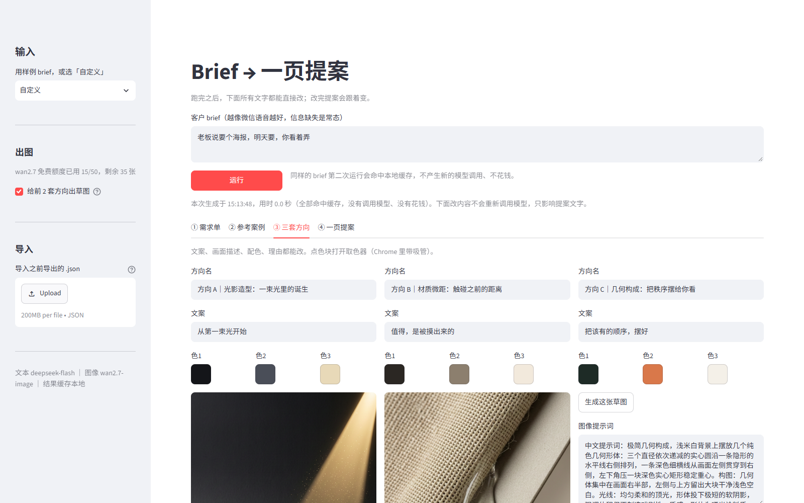
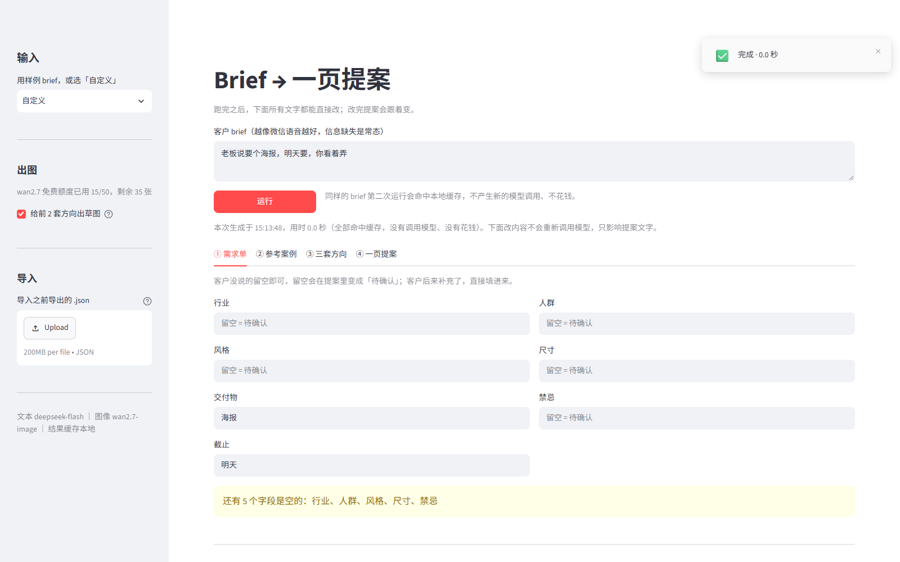
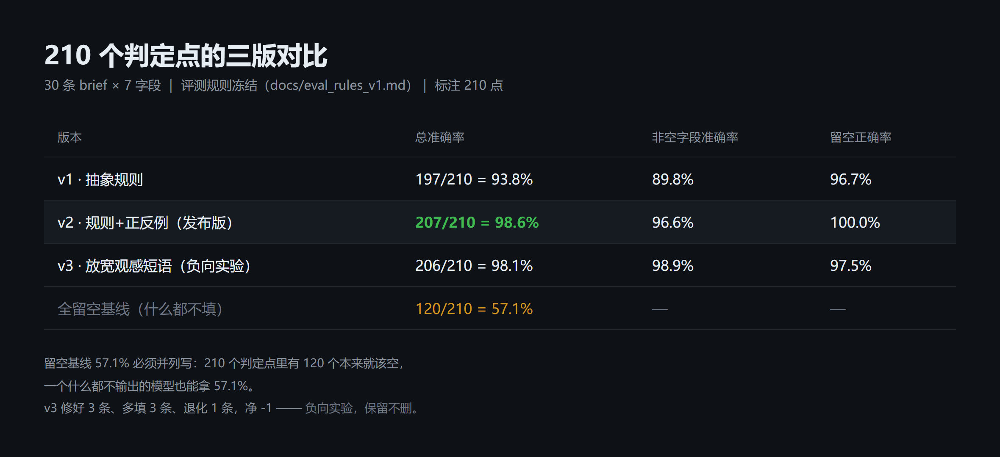
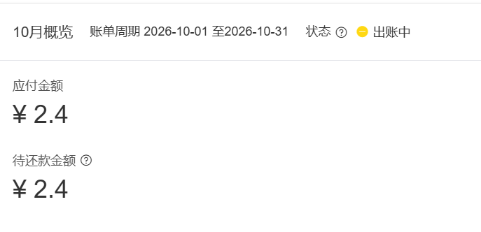
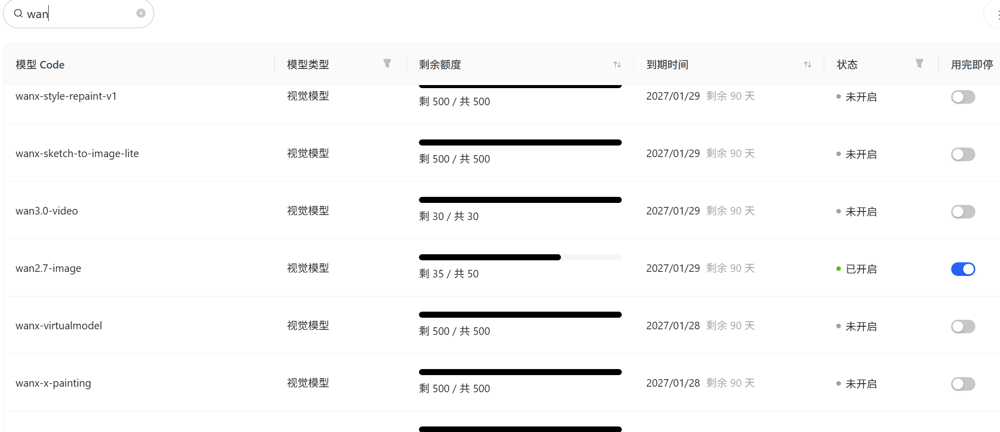

# 海报提案 Agent（Brief → 一页提案）

> **它是什么**：一个**工作流式 Agent**（workflow agent, human-in-the-loop）——固定四步流水线 + 三个可调用的工具（文本模型、案例检索、图像模型），中间产物全部可人工编辑。
> **它不是**：自主 Agent。它不会自己规划下一步、不会自己决定重试、不会在你不知情时花掉一次 API 调用。

把客户一句口语「帮我做个海报」，变成一页可以给客户看的提案初稿：
**结构化需求 → 匹配历史案例 → 三套创意方向 → 一页提案（含草图）**。

目标不是做产品，是验证一件事：**「接需求 → 出方向」这段纯人力环节，能不能被压缩。**



---

## 一句话

设计工作室收到客户口语 brief 后，从 brief 到一版方向草稿约需 90–120 分钟，其中「理需求、找参考、想方向」是纯人力且可压缩的。
这个原型把它压到**约 1 分钟**（30 条回放测试的中位数 41 秒），并且**不确定的信息一律留空、写成"待确认"**，而不是替客户编。

## 快速开始

```bash
pip install openai streamlit pandas
cp .env.example .env    # 填入 DEEPSEEK_API_KEY 与 DASHSCOPE_API_KEY
```

```bash
# 界面
streamlit run app.py

# 命令行跑单条
python pipeline.py b01
python pipeline.py b01 --images 2      # 顺带给前两套方向出草图

# 批量 30 条 + 出指标
python evaluate.py --run --score --tag v2
```

产物在 `data/out/`：`b01_extract.json`、`b01_cases.json`、`b01_ideas.json`、`b01_proposal.md`、`img/<md5>.png`。

## 界面是可编辑的工作台，不是只读结果



跑完之后，四块内容都能直接改，一页提案跟着实时重拼：

| 位置 | 能改什么 |
|---|---|
| ① 需求单 | 7 个字段全部可编辑。客户后来补了信息就填进去，「待确认」会自动减少 |
| ② 参考案例 | 三个槽位可换成案例库里任意一条，选它的理由可改写 |
| ③ 三套方向 | 方向名、文案、图像提示词、理由全部可编辑；配色点色块打开取色器（Chrome 带吸管） |
| ④ 一页提案 | 不是定稿快照，每次都由上面编辑后的值重新拼装；可下载 `.md`，也可导出编辑结果 `.json` |

每套方向下方还有「用当前提示词重出图」——改完提示词可以直接重跑，验证改动的效果。

> 编辑只存在当前浏览器会话里，**刷新页面会重置**，需要留存请点下载。
> 这条限制是刻意的：不做数据库（章程 §1.3），所以状态不落盘。

## 架构

```
                data/briefs.csv (30 条口语 brief, 带 210 个标注)
                        │
                        ▼
  ┌─────────────────────────────────────────────┐
  │ ① 需求结构化  prompts/extract.md            │  7 字段，说不出的留空
  │    → extract.json                            │
  ├─────────────────────────────────────────────┤
  │ ② 案例匹配    prompts/cases.md  + 20 条案例 │  按诉求结构选 3 条，不是按配色
  │    → cases.json                              │
  ├─────────────────────────────────────────────┤
  │ ③ 三套方向    prompts/ideas.md              │  3 套不同视觉机制
  │    → ideas.json                              │
  ├─────────────────────────────────────────────┤
  │ ④ 一页提案    模板拼装（不过模型）          │  事实来自前三步，不会被"赋能闭环"冲淡
  │    → proposal.md                             │
  └─────────────────────────────────────────────┘
                        │
                        ▼
              图像：wan2.7-image（免费额度）+ 本地缓存
```

**为什么第 ④ 步不用模型**：提案的内容（需求、案例、方向、待确认项）全部来自前三步的 JSON。
再过一次模型只会把事实改写成"提升品牌调性"这类空话——这正是它在原始需求里要避免的失败模式。

**为什么 v1 不用向量库**：案例只有 20 条，全量塞进 prompt 更准也更省事。
案例上千条时才需要检索，这是刻意的取舍，写在 Roadmap 里。

## 指标（210 个判定点，30 条 brief × 7 字段）



| 版本 | 改了什么 | 总准确率 | 非空字段 | 留空正确率 |
|---|---|---|---|---|
| v1 | 抽象规则 | 93.8% | 89.8% | 96.7% |
| **v2（发布版）** | 规则+正反例，四条否定约束 | **98.6%** | 96.6% | **100%** |
| v3 | 放宽"观感短语也算风格" | 98.1% | 98.9% | 97.5% |
| 全留空基线 | 什么都不填 | **57.1%** | — | — |

- **v3 是负向实验**：修好 3 条、多填 3 条、退化 1 条，净 -1。保留它，是因为"知道哪次改动是负收益"比"只有一个漂亮数字"更重要。
- **98.6% 要带限定语**：规则用了行业桶、词根匹配、括注剥离，比严格匹配宽；单人标注、非盲评。**对外只主张 v1→v2 的相对提升（+4.8pp）**。
- 评测规则冻结在 [`docs/eval_rules_v1.md`](docs/eval_rules_v1.md)，三版跑同一套；标注修正 2 轮全部记录在 `data/briefs.csv` 备注列。

其余指标：

| 指标 | 结果 |
|---|---|
| 批量稳定性 | 30/30 成功，120/120 产物齐全，0 崩溃 |
| 单条耗时 | 约 41 秒（30 条批量 490 秒 / 30） |
| 幻觉控制 | 留空正确率 100%（v2）：brief 没说的信息，一条都没编 |
| 首轮方向可用率 | **未盲评**（自评 13/15，但评审是作者本人，不算数） |

## 成本账单

| 项 | 数量 | 金额 |
|---|---|---|
| 图像 wan2.6-image（v1.0 演示） | 12 张 | **2.40 元** |
| 图像 wan2.7-image（v1.1，免费额度） | 11 张 | 0.00 元 |
| 文本 deepseek-flash（批量 + 迭代） | 200+ 次 | 待核（账单未出，不编数） |
| **合计（已确认部分）** | | **2.40 元** |

- 单价经账单核实：`wan2.6-image` 0.2 元/张；`qwen-plus` 输入 0.0008、输出 0.002 元/千tokens。
- **图像缓存**：同一提示词第二次运行不产生新请求（`--images` 二次运行实测 5/5 条 0 请求）。




- 选型更新 v1.1 把图像切到 wan2.7（50 张免费额度），后续出图成本归零。

## Roadmap（未实现，只写不做的原因）

| 方向 | 为什么现在不做 |
|---|---|
| 向量检索 | 20 条案例直塞 prompt 更准；上千条时才值得引入 |
| 多品类 | 单品类（活动海报）才能验证"方向质量"，扩品类会稀释评测 |
| 客户反馈回流自动改 prompt | 需要真实客户数据，本项目全部是自造样本 |
| 图像换 wan2.7-image-pro | 有 50 张免费额度，画质更好；当前版本先用 image |

## 已知问题（不藏）

1. **案例匹配的 90 个选择没有人工核对**。已发现 b04（brief 只有"开业"）匹配到母婴双十一压价案例，理由是硬编的。
2. **首轮方向可用率没有盲评**。章程要求"设计朋友盲评 1–5 分"，目前只有作者自评 13/15，不能当指标用。
3. **评测规则的宽松度**：行业桶是人肉定的，遇到新行业会误判。
4. **b22 曾因模型输出损坏的 Unicode 转义失败**，已加清洗与重试，但这类模型侧抖动无法根除。

## 边界声明

**个人项目。** 源于我在江西光棱科技实习期间对图文设计交付流程的观察，公司未立项、无 AI 团队，我用业余时间做原型验证可行性。
素材（20 条案例、30 条 brief）全部自造脱敏，**未使用任何客户资料或公司内部数据**。
本项目不替代设计师判断：方向的作用是把人从空白页推到"改"，不是替代"选"。

## 截图

| 图 | 说明 |
|---|---|
| [需求单](docs/img/screens/01-需求单待确认.png) | 5 个字段留空并提示"要去问客户"，不是编 |
| [三套方向](docs/img/screens/02-三套方向.png) | 三种不同视觉机制 + 配色 + 提示词 + 草图 |
| [一页提案](docs/img/screens/03-一页提案.png) | 最终产物，可下载 md / 导出 json |
| [指标对比](docs/img/screens/04-指标三版对比.png) | 三版 210 判定点，含全留空基线 |
| [成本账单](docs/img/screens/05-成本账单.png) | 10 月账单周期，应付 ¥2.4（唯一一次付费） |
| [免费额度](docs/img/screens/06-免费额度.png) | wan2.7-image 剩 35/50，图像成本为 0 的来源 |

## 目录

```
app.py                  Streamlit 单页（4 tab）
pipeline.py             单条流水线（CLI）
evaluate.py             批量跑 + 评测（含冻结规则）
src/llm.py              模型调用、缓存、JSON 解析
src/images.py           图像生成 + 缓存
prompts/                当前 prompt（v2）
prompts/v1/             v1 快照
data/briefs.csv         30 条 brief + 210 个标注
data/cases.csv          20 条自造案例
data/out/               产物 + eval_v1/v2/v3.csv
docs/                   章程、评测规则、badcase、每日记录
```
